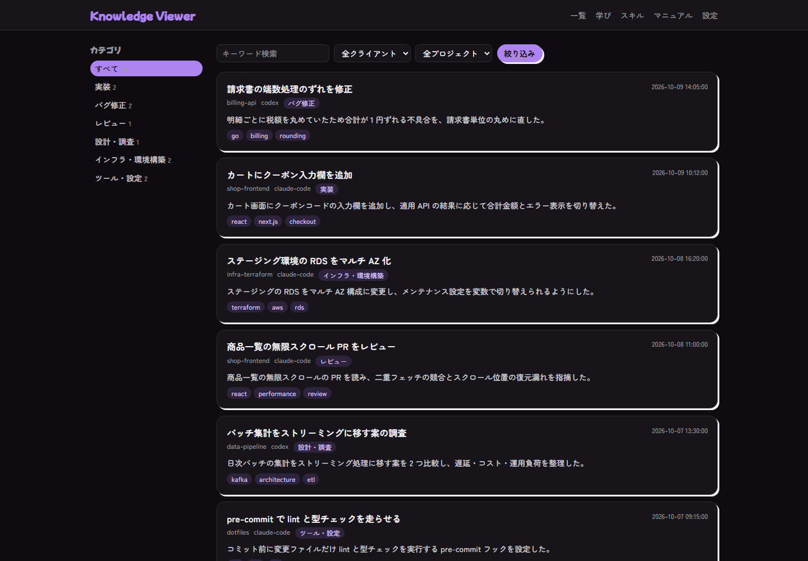
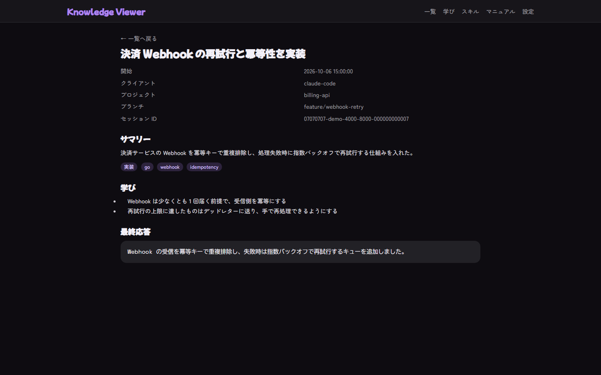
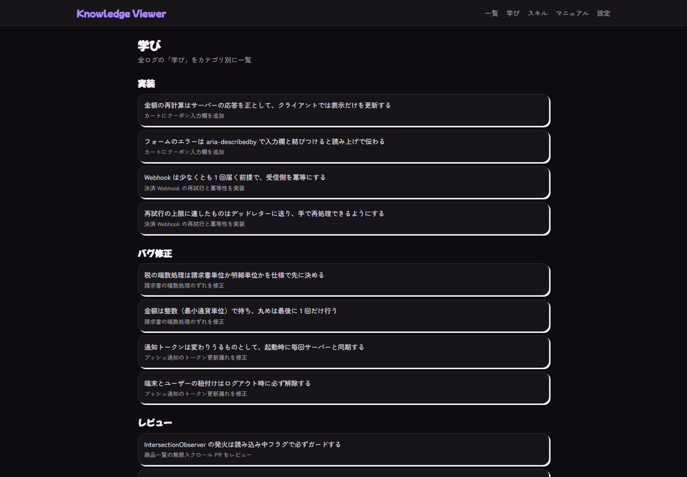
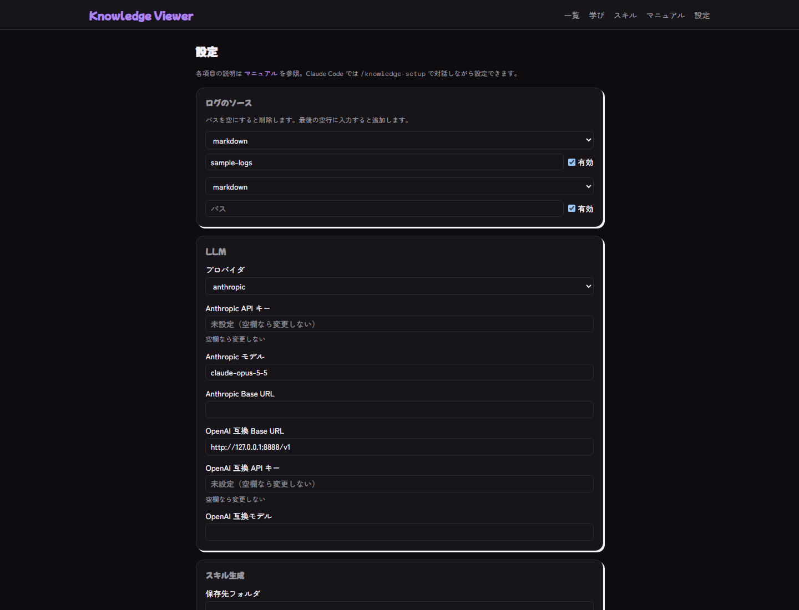

# Knowledge Viewer

Claude Code / Codex の会話ログを読み込み、LLM でサマリー・カテゴリ・タグ・学びを付けて、ナレッジとして閲覧する Next.js アプリです。

<picture>
  <source media="(prefers-color-scheme: dark)" srcset="docs/architecture/architecture-dark.svg">
  
</picture>

仕様は `SPEC.md`、設定のマニュアルは `docs/MANUAL.md`（アプリでは `/manual`）、汎用化の設計は `docs/design/generalize.md`、作業メモは `NEXT-STEPS.md` を参照してください。

## 画面イメージ

デモ用の架空のログで撮影したもの。

| 一覧 | 詳細 |
| --- | --- |
|  |  |
| **学び** | **設定** |
|  |  |

## セットアップ

### Claude Code で自動セットアップ

リポジトリで Claude Code を開き、`/knowledge-setup` と入力する。依存の導入・ログの検出・設定・起動まで対話で進む。
API キーは自分で `.env.local`（雛形は `.env.local.example`）か設定画面に入れる。チャットには貼らない。

### 手動でセットアップ

```bash
pnpm install
pnpm dev           # http://127.0.0.1:3000
```

1. ブラウザで `/settings` を開き、ログの場所、使う LLM、API キーを設定して保存する。
2. 未解析のログを LLM で解析する。

```bash
pnpm analyze
pnpm analyze --limit N   # 先頭 N 件だけ解析する (動作確認向け)
```

解析は 1 件ごとに保存されるので、途中で止めても次回は続きから始まる。失敗したログは未解析のまま残り、再実行で再試行される。
新規・更新されたログだけが再解析される。

設定項目の詳細は [マニュアル](docs/MANUAL.md) を参照してください。

## 読めるログ

| 種類 | 既定の場所 |
| --- | --- |
| Claude Code の生ログ (JSONL) | `~/.claude/projects` |
| Codex の生ログ (JSONL) | `~/.codex/sessions` |
| session-log 形式の Markdown | 設定画面で指定 (環境変数 `LOG_ROOT` でも指定できる) |

場所は `/settings` で変更・追加できる。同じセッション (sessionId が同じもの) が複数のソースにあるときは 1 件にまとめ、Markdown を優先する。
ログフォルダは読み取り専用で、アプリは書き込み・削除をしない。
詳細は [マニュアル](docs/MANUAL.md) を参照してください。

## LLM

`/settings` で次の 2 つを切り替える。

- Anthropic: 既定モデルは `claude-opus-5-5`。
- OpenAI 互換: ローカル LLM や OpenAI など。ベース URL・API キー・モデル名を指定する (ベース URL の既定は `http://127.0.0.1:8888/v1`)。

API キーは `data/settings.json` に **平文** で保存される (画面では末尾 4 文字以外を伏せて表示する)。
次の環境変数があれば、設定画面の値より優先される。ただし `LOG_ROOT` は既存のソースを置き換えず、ソースを 1 件追加する。`.env.local` に書ける (雛形は `.env.local.example`)。
詳細は [マニュアル](docs/MANUAL.md) を参照してください。

| 変数 | 内容 |
| --- | --- |
| `ANTHROPIC_API_KEY` | Anthropic の API キー |
| `LLM_BASE_URL` | OpenAI 互換 API のベース URL |
| `LLM_API_KEY` | OpenAI 互換 API のキー |
| `LLM_MODEL` | OpenAI 互換 API のモデル名 |
| `LOG_ROOT` | Markdown ログの置き場所。既存のソースは置き換えず、`markdown` のソースとして追加する |
| `KV_DATA_DIR` | `data/` の場所を変える (既定はアプリを起動したフォルダの `data`) |

## 画面

- `/` : ログの一覧。サイドバーのカテゴリで絞り込む。クエリは次のとおりで、互いに保持される。
  - `q` : タイトル・サマリー・タグの検索
  - `category` : カテゴリ。`未解析` を指定すると未解析のログだけを表示する
  - `client` / `project` : クライアントとプロジェクト
  - `tag` : タグ (一覧と詳細のタグをクリックすると移動する)
- `/log/[id]` : 1 件の詳細 (サマリー、学び、最終応答)
- `/learnings` : 学びをカテゴリごとにまとめて表示
- `/settings` : ログの場所、LLM、API キー、スキルの設定
- `/skills` : スキルの生成 (プレビュー、インストール)
- `/manual` : 設定マニュアル (`docs/MANUAL.md` と同じ内容)

## コマンド

| コマンド | 内容 |
| --- | --- |
| `pnpm analyze` | 未解析のログを解析する。`--limit N` で件数を制限 |
| `pnpm digest --period daily` | 日次ダイジェスト (Markdown) を標準出力に出す |
| `pnpm digest --period weekly` | 週次ダイジェスト。`--now <日時>` で基準時刻を指定できる |
| `pnpm configure detect` | 現在の設定を JSON で出す (API キーは有無のみ) |
| `pnpm configure apply <パッチ.json>` | 部分的な設定の JSON を設定ファイルにマージして保存する |
| `pnpm dev` / `pnpm start` | 開発 / 本番サーバー |
| `pnpm build` / `pnpm lint` | ビルド / Lint |

ダイジェストの期間は、ログの中の最終更新時刻 (Markdown ヘッダの「最終更新」、生ログの最後の時刻) で判定する。ファイルの更新時刻ではない。

## スキル生成

`/skills` で次の 2 つを生成し、`~/.claude` 配下にインストールできる。

- セッション保管スキル (Claude Code): 会話の JSONL を保管先にコピーし、要約を書く。**Stop フックの登録が必要** (画面に表示される断片を `~/.claude/settings.json` に自分で追記する。アプリは書き換えない)。
- 日次・週次ダイジェストの定期実行タスク (Claude Desktop): `npm run digest` の出力を Slack に投稿する（タスクは Node.js 同梱の npm で実行するので、pnpm が無い環境でも動く）。**Slack コネクタが必要**。頻度は Desktop の画面で選ぶ。アプリが起動中で PC が起きている間だけ動く。
詳細は [マニュアル](docs/MANUAL.md) を参照してください。

## データの置き場所

`data/` 配下 (`.gitignore` 済み)。`KV_DATA_DIR` で変更できる。
詳細は [マニュアル](docs/MANUAL.md) を参照してください。

- `data/settings.json` : 設定 (API キーを含む)
- `data/analysis.json` : 解析結果
- `data/log-index.json` : 生ログの読み取りキャッシュ

## セキュリティ

- `pnpm dev` / `pnpm start` は `127.0.0.1` だけで待ち受ける。
- 設定保存とスキルのインストールの API は、別のサイトや LAN からのリクエストを拒否する。

## 開発メモ

Next.js 16 (App Router) + TypeScript + Tailwind CSS。DB は使わず、各ページは Server Component でファイルを直接読む。
型チェックは `pnpm exec tsc --noEmit`。パッケージマネージャーは pnpm（`package.json` の `packageManager`）。
アーキ図のソースは `docs/architecture/architecture.d2`。構成を変えたら arch-diagram スキルで描き直す。

## ブランチ

- `main`: 公開・リリース用。`develop` から取り込む。
- `develop`: 開発の統合先。作業は `develop` からブランチを切って戻す。

## ライセンス

[MIT](LICENSE)
