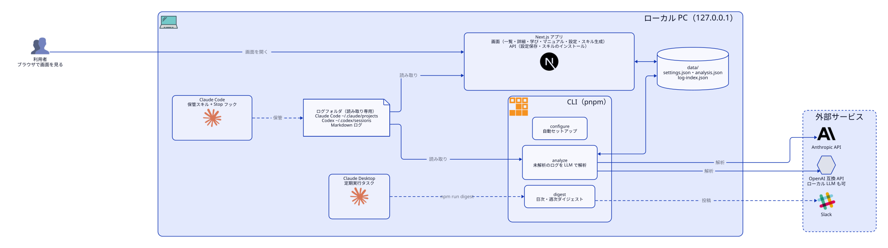

# Knowledge Viewer マニュアル

Claude Code / Codex の会話ログを読み込み、LLM でサマリー・カテゴリ・タグ・学びを付けて閲覧する Next.js アプリの設定マニュアルである。設定項目、環境変数、`pnpm configure`、スキル生成、トラブル対応をまとめる。

## 全体像

<picture>
  <source media="(prefers-color-scheme: dark)" srcset="architecture/architecture-dark.svg">
  
</picture>

アプリはログのソース（Claude Code・Codex・Markdown）を読み取り専用で読み、LLM で解析した結果を `data/` に保存して、画面で表示する。設定は `/settings` 画面、`pnpm configure`、環境変数のいずれでも変えられる。スキル生成を使うと、会話の保管と要約、ダイジェストの Slack 投稿もできる。

## セットアップ

### Claude Code で自動セットアップ

リポジトリで Claude Code を開き、`/knowledge-setup`（または「セットアップして」）と入力する。スキルは次の順で対話しながら進める。

1. 前提の確認と `pnpm install`（Node.js 22 以上、pnpm が必要）
2. `pnpm configure detect` で現状を把握する
3. 使う LLM、ログの場所、スキル生成の有無を質問する
4. 答えから設定のパッチを作り、`pnpm configure apply` で反映する
5. API キーを入れてもらう（利用者が自分で入れる）
6. 同意があれば `pnpm analyze --limit 1` で動作確認する
7. `pnpm dev` で起動する

API キーはチャットで渡さない。`.env.local`（雛形は `.env.local.example`）に書くか、起動後に `/settings` で入れる。スキルは `.env.local` と `~/.claude/settings.json` を読み書きしない。

### 手動でセットアップ

```bash
pnpm install
pnpm dev           # http://127.0.0.1:3000
```

1. ブラウザで `/settings` を開き、ログの場所、使う LLM、API キーを設定して保存する。
2. 未解析のログを解析する。

```bash
pnpm analyze
pnpm analyze --limit N   # 先頭 N 件だけ解析する (動作確認向け)
```

解析は 1 件ごとに保存され、途中で止めても続きから始まる。失敗したログは未解析のまま残り、再実行で再試行される。

## 設定項目

設定画面（`/settings`）は 3 つのセクションから成る。「設定ファイルのキー」は `data/settings.json` と `pnpm configure apply` のパッチで使うキーである。設定ファイルが無い、または読めないときは既定値が使われる。

### ログのソース

`sources` は配列で、要素ごとに次のキーを持つ。

| 項目 | 設定ファイルのキー | 既定値 | 説明 |
| --- | --- | --- | --- |
| 種類 | `sources[].type` | `claude-code` / `codex` | ログの形式（下表） |
| パス | `sources[].path` | `~/.claude/projects` / `~/.codex/sessions` | ログのフォルダ。`~/` で始まるパスはホームに展開する |
| 有効 | `sources[].enabled` | `true` | `false` にすると読まない |
| ID | `sources[].id` | `claude-code` / `codex` | 画面から追加した行には自動で付く |

既定では `claude-code` と `codex` の 2 件がある。

| 種類 | 読むもの |
| --- | --- |
| `claude-code` | Claude Code の生ログ（JSONL） |
| `codex` | Codex の生ログ（JSONL） |
| `markdown` | session-log 形式の Markdown |

- 追加: 画面の最後の空行に種類とパスを入れて保存する。
- 削除: パスを空にして保存する。
- 同じセッション（`sessionId` が同じもの）が複数のソースにあるときは 1 件にまとめ、Markdown を優先する。
- フォルダが存在しないソースは警告を出して飛ばす。
- ログのフォルダは読み取り専用で、アプリは書き込み・削除をしない。

### LLM

| 項目 | 設定ファイルのキー | 既定値 | 説明 |
| --- | --- | --- | --- |
| プロバイダ | `llm.provider` | `anthropic` | `anthropic` か `openai-compatible` |
| Anthropic API キー | `llm.anthropic.apiKey` | 空 | 平文で保存。画面では末尾 4 文字以外を伏せ、空欄で保存すると変更しない |
| Anthropic モデル | `llm.anthropic.model` | `claude-opus-5-5` | 使うモデル名 |
| Anthropic Base URL | `llm.anthropic.baseUrl` | 空 | 空なら標準の接続先 |
| OpenAI 互換 Base URL | `llm.openai.baseUrl` | `http://127.0.0.1:8888/v1` | ローカル LLM や OpenAI など |
| OpenAI 互換 API キー | `llm.openai.apiKey` | 空 | 平文で保存。扱いは Anthropic と同じ |
| OpenAI 互換モデル | `llm.openai.model` | 空 | 使うモデル名 |

### スキル生成

| 項目 | 設定ファイルのキー | 既定値 | 説明 |
| --- | --- | --- | --- |
| 保存先フォルダ | `skills.storeDir` | 空 | セッション保管スキルの保管先 |
| Slack チャンネル | `skills.slackChannel` | 空 | ダイジェストの投稿先 |
| アプリのフォルダ | `skills.appDir` | アプリを起動したフォルダ | 定期実行タスクがコマンドを実行する場所 |

`skills.storeDir` を設定すると、`<storeDir>/claude-code` がログのソース（`claude-code` 形式）に自動で加わる。設定ファイルには書き込まれず、同じパスのソースが既にあれば足されない。

## 環境変数と優先順位

環境変数は `.env.local` に書ける（雛形は `.env.local.example`）。空文字は未設定として扱う。

| 変数 | 対応する設定 | 説明 |
| --- | --- | --- |
| `ANTHROPIC_API_KEY` | `llm.anthropic.apiKey` | Anthropic の API キー |
| `LLM_BASE_URL` | `llm.openai.baseUrl` | OpenAI 互換 API のベース URL |
| `LLM_API_KEY` | `llm.openai.apiKey` | OpenAI 互換 API のキー |
| `LLM_MODEL` | `llm.openai.model` | OpenAI 互換 API のモデル名 |
| `LOG_ROOT` | （ソースを追加） | Markdown ログの置き場所。同じパスのソースが無ければ `markdown` のソースとして追加する |
| `KV_DATA_DIR` | （保存先） | `data/` の場所を変える。既定はアプリを起動したフォルダの `data` |

- 環境変数は設定画面・設定ファイルの値より優先される。`LOG_ROOT` は既存のソースを置き換えず、追加する。
- 環境変数で上書きされている項目（`LOG_ROOT`、`ANTHROPIC_API_KEY`、`LLM_BASE_URL`、`LLM_API_KEY`、`LLM_MODEL` のうち設定済みのもの）は、設定画面の上部に「環境変数で上書きされている項目」として出る。`KV_DATA_DIR` は表示の対象外である。
- 設定画面は設定ファイルの値を表示する。環境変数の値は表示されず、画面で変えても環境変数が勝つ。
- 設定ファイル（`data/settings.json`）が無く、`LLM_BASE_URL` が設定されているときは、プロバイダが `openai-compatible` になる。設定ファイルを一度保存すると、`llm.provider` はその値に従う。

## pnpm configure

設定の確認と反映を行う CLI である。リポジトリのルートで実行する。`.env.local` があれば読み込む。

### detect

```bash
pnpm configure detect
```

現在の設定を JSON で出す。API キーの値は出さず、有無だけを出す。

| 項目 | 内容 |
| --- | --- |
| `settingsFile` / `settingsExists` | 設定ファイルのパスと、その有無 |
| `sources` | 有効な設定のソース（環境変数・保存先から加わるものを含む）と、パスの有無（`exists`） |
| `defaults` | 既定のログの場所（`claude-code`・`codex`）と、その有無 |
| `llm` | `provider`、各プロバイダのモデル名・ベース URL、キーの有無（`hasKey`） |
| `skills` | `storeDir`、`slackChannel`、`appDir` |
| `envOverrides` | 設定を上書きしている環境変数の名前 |

### apply

```bash
pnpm configure apply <パッチ.json>
```

部分的な設定の JSON ファイルを、設定ファイルにマージして保存する。成功すると `detect` と同じ JSON を出す。

- オブジェクトはキーごとにディープマージする。指定しなかった項目は変わらない。
- 配列（`sources`）は置き換わる。残したいソースも含めて全部を書く。
- `apiKey` というキーが含まれるパッチは、深さにかかわらず拒否する。API キーは `.env.local` か設定画面で入れる。
- JSON として読めない、または設定の形に合わないときは、エラーを JSON で出して失敗する。

パッチの例:

```json
{
  "llm": { "provider": "openai-compatible", "openai": { "baseUrl": "http://127.0.0.1:8888/v1", "model": "my-model" } },
  "sources": [
    { "id": "claude-code", "type": "claude-code", "path": "C:\\Users\\me\\.claude\\projects", "enabled": true },
    { "id": "notes", "type": "markdown", "path": "C:\\path\\to\\AI", "enabled": true }
  ],
  "skills": { "storeDir": "C:\\path\\to\\store", "slackChannel": "#knowledge" }
}
```

## スキル生成と定期実行

`/skills` で次の 2 つを生成し、`~/.claude` 配下にインストールできる。

- セッション保管スキル（Claude Code）: Stop フックで会話の JSONL を `<storeDir>/claude-code` にコピーし、スキルが要約を `<storeDir>/summaries/<session_id>.json` に書く。アプリはこの要約を表示に使う。**Stop フックの登録が必要**で、画面に表示される断片を `~/.claude/settings.json` に自分で追記する。アプリは `~/.claude/settings.json` を書き換えない。
- 日次・週次ダイジェストの定期実行タスク（Claude Desktop）: `npm run digest` の出力を Slack に投稿する。**Slack コネクタが必要**。頻度は Desktop の画面で選ぶ。アプリが起動中で PC が起きている間だけ動く。

ダイジェストは CLI でも出せる。

| コマンド | 内容 |
| --- | --- |
| `pnpm digest --period daily` | 日次ダイジェスト（Markdown）を標準出力に出す |
| `pnpm digest --period weekly` | 週次ダイジェスト。`--now <日時>` で基準時刻を指定できる |

## データの置き場所

`data/` 配下に置く（`.gitignore` 済み）。`KV_DATA_DIR` で変更できる。

| ファイル | 内容 |
| --- | --- |
| `data/settings.json` | 設定。**API キーは平文で保存される** |
| `data/analysis.json` | LLM の解析結果 |
| `data/log-index.json` | 生ログの読み取りキャッシュ。消しても再生成される |

## セキュリティ

- `pnpm dev` / `pnpm start` は `127.0.0.1` だけで待ち受ける。
- 設定保存とスキルのインストールの API は、別のオリジン（別のサイト）や LAN など localhost 以外からのリクエストを 403 で拒否する。
- API キーは `data/settings.json` に平文で保存する。このファイルを共有やコミットしない。画面では末尾 4 文字以外を伏せ、`pnpm configure detect` は有無しか出さない。
- 環境変数で渡すなら `.env.local` を使い、コミットしない。
- ログのフォルダは読み取り専用で、アプリは書き込み・削除をしない。

## トラブルシューティング

### ログが一覧に出ない

- `pnpm configure detect` で `sources` の `exists` と `enabled` を確かめる。`exists` が `false` ならパスが違う。
- 種類（`claude-code` / `codex` / `markdown`）がログの形式と合っているか確かめる。
- 同じ `sessionId` が複数のソースにあると 1 件にまとまる。
- 直し方: `/settings` でパスと種類を直して保存する。

### 解析が失敗する／キーが効かない

- `pnpm configure detect` で、使うプロバイダの `llm.*.hasKey` が `true` か、`llm.provider` が合っているか確かめる。
- OpenAI 互換は、ベース URL とモデル名が空でないか、サーバーが起動しているか確かめる。
- `envOverrides` に環境変数があれば、その値が使われている。古いキーが `.env.local` に残っていないか確かめる。
- 直し方: キーを `.env.local` か `/settings` で入れ直し、`pnpm analyze` を再実行する。失敗したログは再試行される。

### 環境変数の値が画面で変えられない

- 設定画面の上部に「環境変数で上書きされている項目」が出ていれば、その環境変数が優先される。
- 直し方: `.env.local` などから該当の変数を消すか空にして、`pnpm dev` を再起動する。

### 保管スキルの要約が出ない（Stop フック未登録）

- `<storeDir>/last-session.json` が無い、または作業ディレクトリのキーが無ければ、Stop フックが動いていない。
- `skills.storeDir` が設定されているか、`<storeDir>/summaries/` に JSON があるか確かめる。
- 直し方: `/skills` に表示される Stop フックの断片を `~/.claude/settings.json` に追記し、Claude Code を開き直す。

### ダイジェストに古いログが入る／入らない（最終更新時刻で判定）

- 期間の判定には、ログの中の最終更新時刻（Markdown ヘッダの「最終更新」、生ログの最後の時刻）を使う。ファイルの更新時刻ではない。
- ファイルをコピーや移動して更新時刻が変わっても、ダイジェストの対象は変わらない。
- 直し方: ログの中身の最終更新時刻を確かめる。基準時刻を変えて試すときは `--now <日時>` を使う。

## アーキ図の描き直し

構成を変えたら、`docs/architecture/architecture.d2` を直して図を描き直す。arch-diagram スキルに頼むか、arch-diagram スキルの `scripts/render.py docs/architecture/architecture.d2` を実行する。ライト用とダーク用の SVG が `docs/architecture/` に出力される。
